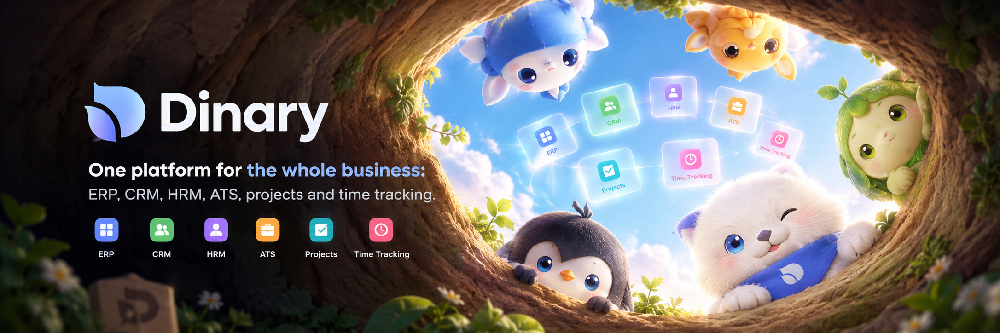

<p align="center">
  
</p>

# Dinary

**One platform for the whole business: ERP, CRM, HRM, ATS, projects and time tracking.**

Dinary is an open-source business management platform that replaces a stack of disconnected tools with a single system for people, customers, money, projects and time — available as a web app, a self-hosted server and desktop applications.

[](LICENSE)
[](https://nodejs.org)
[](https://angular.dev)
[](https://nestjs.com)
[](https://nx.dev)
[](.github/CONTRIBUTING.md)

## Why Dinary

Most small and mid-sized companies run on a patchwork of spreadsheets, invoicing tools, a CRM nobody updates and a time tracker bolted onto payroll. Dinary keeps that data in one place, under one permission model, in one UI.

- **One data model.** An employee, a contact, a project, an invoice and a timesheet are related records, not exports.
- **Everything time-aware.** Time tracking, activity, timesheets, approvals and billing draw from the same source.
- **Self-hosted first.** SQLite for a single team, PostgreSQL for production; run it on a laptop, a VPS or Kubernetes.
- **Open source, no lock-in.** AGPL-3.0, TypeScript end to end, standard PostgreSQL and S3-compatible storage.
- **Extensible.** Integrations (GitHub, Jira, Plane, Zapier, Make, Activepieces, Upwork, Hubstaff, AI providers) live in isolated plugins.
- **Multi-tenant.** Multiple organizations, departments, teams, roles and permissions out of the box.

## Features

| Area | What you get |
| --- | --- |
| **Finance & accounting** | Invoices, estimates, proposals, payments, income, expenses, recurring invoices, taxes and accounting templates |
| **Sales & CRM** | Contacts, clients, leads, pipelines, deals, vendors and activity history |
| **People & HR** | Employees, departments, teams, positions, employment types, approvals, time off, onboarding and offboarding |
| **Time tracking** | Timesheets, activity monitoring, screenshots, apps and URLs, manual time, approvals and reporting |
| **Projects & delivery** | Projects, tasks, goals, KPIs/OKRs, sprints, estimates and team dashboards |
| **Recruiting (ATS)** | Jobs, candidates, interviews, proposals and a public job board |
| **Operations** | Inventory, equipment, supply chain, purchasing, production and document management |
| **Platform** | Multi-organization, roles and permissions, email history and templates, import/export, file storage, i18n, themes and a headless API |

## Tech stack

| Layer | Technology |
| --- | --- |
| Frontend | Angular 22, RxJS, Nebular, SCSS |
| Backend | NestJS 12, TypeORM / MikroORM / Knex, GraphQL and REST |
| Monorepo | Nx 23, Yarn workspaces, TypeScript 6 |
| Data | SQLite (default), PostgreSQL 14+ or MySQL for production |
| Desktop | Electron (desktop app, timer, server and API server) |
| Deployment | Docker Compose, Kubernetes, DigitalOcean, SSH |

## Quick start

### Requirements

- **Node.js 26.x** (pinned in `.nvmrc`)
- **Yarn 1.22.x**
- No database server needed for local development — the default configuration uses SQLite.

### Run locally

```bash
git clone https://github.com/truongdatdev/dinary.git
cd dinary

npm i -g yarn
yarn bootstrap          # install dependencies and run the required postinstall steps
cp .env.sample .env.local

yarn start              # API on :3000, web UI on :4200
```

Open <http://localhost:4200>. The API is served at <http://localhost:3000/api>.

On first start the API creates its schema and seeds the minimum data set when no users exist. To load the default organization and employees:

```bash
yarn seed:dinary        # default tenant, organization and employee fixtures
yarn seed:all           # larger demo data set
```

### Run with Docker

```bash
docker compose -f docker-compose.demo.yml up
```

The demo stack uses prebuilt images and listens on <http://localhost:4200>. For a production stack, copy `.env.compose`, set strong secrets, then run `docker compose up -d`. The full procedure is documented in [the deployment section](#deployment).

### Demo accounts

With `DEMO=true`, a fresh demo installation accepts:

| Role | Email | Password |
| --- | --- | --- |
| Super Admin | `admin@dinary.app` | `admin` |
| Employee | `employee@dinary.app` | `12345678` |

These credentials exist **only in demo mode**. A production installation must set `DEMO_SUPER_ADMIN_PASSWORD`, `DEMO_ADMIN_PASSWORD` and `DEMO_EMPLOYEE_PASSWORD` before its first boot — the API refuses to seed with the shipped defaults. Dinary Server and the desktop apps instead generate a random password per account on first start and display it once.

## Project structure

```text
apps/
  dinary/            Angular web application
  api/               NestJS API
  desktop/           Electron desktop application
  desktop-timer/     Electron time-tracking application
  server*/           Self-hosted server distributions
packages/
  core/              Domain modules (employees, invoices, projects, …)
  plugins/           Integrations, auth providers and UI plugins
  ui-core/           Shared UI components, themes and i18n
  contracts/         Shared types and DTOs
tools/               Workspace tooling and architecture guardrails
.deploy/             Docker, Kubernetes and cloud deployment assets
```

## Scripts

| Command | Description |
| --- | --- |
| `yarn start` | Run the API and web UI together |
| `yarn start:api` | Run the API only (`:3000`) |
| `yarn start:dinary` | Run the web UI only (`:4200`) |
| `yarn build` | Build the workspace |
| `yarn build:api` / `yarn build:dinary` | Build one application |
| `yarn test` | Run the test suites |
| `yarn lint` | Lint the workspace |
| `yarn seed:dinary` | Seed the default Dinary data set |
| `yarn seed:all` | Seed the full demo data set |
| `yarn format` | Format the workspace with Prettier |

## Configuration

Settings are read from `.env.local` (or `.env`) at startup. The most important ones:

| Variable | Default | Purpose |
| --- | --- | --- |
| `API_PORT` | `3000` | API port |
| `CLIENT_BASE_URL` | `http://localhost:4200` | Public URL of the web app |
| `DB_TYPE` | `better-sqlite3` | `better-sqlite3`, `postgres` or `mysql` |
| `DB_HOST` / `DB_PORT` / `DB_NAME` / `DB_USER` / `DB_PASS` | — | Database connection for PostgreSQL/MySQL |
| `DB_SYNCHRONIZE` | `false` | Let the ORM create the schema (development only) |
| `REDIS_ENABLED` | `false` | Required for multiple API replicas and the worker queue |
| `FILE_PROVIDER` | `LOCAL` | `LOCAL`, `S3`, `WASABI` or `CLOUDINARY` |
| `JWT_SECRET`, `JWT_REFRESH_TOKEN_SECRET`, `EXPRESS_SESSION_SECRET` | — | **Must be changed in production** |
| `DEMO` | `false` | Enable demo mode and demo accounts |

The full list, with comments, is in [`.env.sample`](.env.sample).

## Deployment

### Docker Compose

```bash
cp .env.compose .env
# set JWT_SECRET, JWT_REFRESH_TOKEN_SECRET, JWT_VERIFICATION_TOKEN_SECRET,
# EXPRESS_SESSION_SECRET and the DEMO_*_PASSWORD values
docker compose up -d
```

To build the images locally instead of pulling them:

```bash
docker compose -f docker-compose.build.yml up -d
```

The production stack runs the API, the web app, PostgreSQL, Redis and a worker container. Set `REDIS_ENABLED=true` whenever more than one API replica runs.

### Kubernetes

Manifests live in [`.deploy/k8s`](.deploy/k8s). They cover the API, web app, worker, database, Redis and ingress.

### Virtual machines

Deployment helpers for Ubuntu servers and DigitalOcean Droplets are in [`.deploy/ssh`](.deploy/ssh) and [`.do`](.do). Example CI/CD workflows are in [`.github/workflows`](.github/workflows).

## Security

Dinary is provided **as is**, without warranty. In production, terminate TLS in front of the API and the web app, rotate the JWT and session secrets, and run with a least-privilege database user.

To report a vulnerability, use the private advisory form in the [Security tab](https://github.com/truongdatdev/dinary/security/advisories/new) instead of opening a public issue.

## Contributing

- Read [the contributing guide](.github/CONTRIBUTING.md) before opening a pull request.
- Base pull requests on `main` and keep commits focused.
- Report bugs and feature requests in the [issue tracker](https://github.com/truongdatdev/dinary/issues).

## License

Dinary is free software released under the [GNU Affero General Public License v3.0](LICENSE). You may redistribute and/or modify it under the terms of the AGPL-3.0, provided that copyright and license notices are preserved and that the complete source code of modified versions is made available — including when the modified version is offered as a network service.

The copyright notices and attribution for the software Dinary is built on are preserved in [NOTICE.md](NOTICE.md), [LICENSES.md](LICENSES.md) and [CREDITS.md](CREDITS.md), as the AGPL-3.0 requires.

## Trademarks

The **Dinary** name and logo identify this project. All other product names used in this repository are the trademarks or registered trademarks of their respective owners; they are referenced only to describe integrations and compatibility.

## Links

- **Website:** <https://dinary.app>
- **Documentation:** <https://docs.dinary.app>
- **Source code:** <https://github.com/truongdatdev/dinary>
- **Issues:** <https://github.com/truongdatdev/dinary/issues>

---

Copyright © 2026 Dinary contributors.
